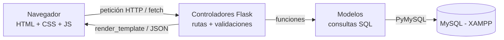
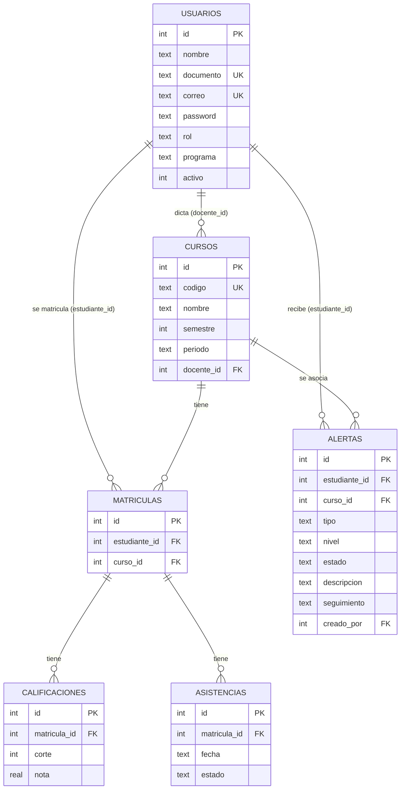

# 🎓 Institución Educativa La Fe – Sistema de Seguimiento Académico Estudiantil

Proyecto final · **Herramientas Computacionales** · Ingeniería de Sistemas · Universidad Cooperativa de Colombia (2026-2)

**Integrantes:** Alejandro Ceballos Salgado · Rodrigo Hernández · Mario Charrasquiel · Santiago Ramos Guerrero
**Docente:** Delia Herazo

---

## 📌 Problema

Las instituciones tienen dificultades para identificar y hacer seguimiento oportuno a estudiantes con
**bajo rendimiento, inasistencias y riesgo académico**. La información de notas y asistencia está dispersa y
las alertas llegan tarde (normalmente al final del semestre).

## 🎯 Objetivo general

Desarrollar una plataforma web para **registrar y analizar información académica** (calificaciones y asistencia)
y **generar alertas de seguimiento** que permitan actuar a tiempo.

### Objetivos específicos
1. Gestionar usuarios con 4 roles: administrador, coordinador, docente y estudiante.
2. Registrar calificaciones por corte (30% - 30% - 40%) y calcular el promedio automáticamente.
3. Registrar la asistencia por clase y calcular el porcentaje de inasistencia.
4. Generar alertas automáticas cuando el promedio es menor a 3.0 o las fallas superan el 20%.
5. Mostrar un dashboard con indicadores y un reporte filtrable y exportable.

---

## 🧩 Módulos

| Módulo | Qué hace | Roles |
|---|---|---|
| **Login** | Inicio de sesión con contraseña cifrada y permisos por rol | Todos |
| **Usuarios** | CRUD completo + búsqueda en vivo (Fetch API) | Administrador |
| **Cursos** | CRUD de asignaturas y matrícula de estudiantes (automática por grupo) | Administrador, coordinador (docente solo ve los suyos) |
| **Calificaciones** | Planilla de notas por corte, promedio en vivo, crear/editar/borrar notas | Admin, coordinador, docente |
| **Asistencia** | Toma de asistencia por fecha, historial y eliminación de una clase | Admin, coordinador, docente |
| **Alertas** | CRUD de alertas, generación automática, filtros y seguimiento | Admin, coordinador, docente |
| **Panel principal** | Indicadores y gráficas (datos traídos con `fetch` en JSON) | Admin, coordinador, docente |
| **Reportes** | Filtros (curso, programa, riesgo, búsqueda), orden por columnas | Admin, coordinador, docente |
| **Mi panel** | El estudiante ve sus notas, asistencia y alertas | Estudiante |

### ¿Cómo se calcula el riesgo?
- **Bajo rendimiento:** promedio ponderado < 3.0
- **Inasistencia:** fallas > 20% de las clases
- **Riesgo alto:** las dos cosas a la vez, o promedio < 2.0
- **Riesgo medio:** solo una de las dos

Las alertas se generan solas al guardar notas o asistencia, y también con el botón **⚡ Generar automáticas**.
No se repiten mientras la alerta anterior siga abierta o en seguimiento.

---

## 🛠️ Tecnologías

- **Backend:** Python 3 + Flask (Blueprints)
- **Base de datos:** MySQL / MariaDB de **XAMPP** (conexión con `PyMySQL`)
- **Frontend:** HTML5 semántico, CSS3 propio (responsive), JavaScript (eventos, validaciones, Fetch API)
- **Seguridad:** contraseñas con hash (`werkzeug.security`), sesiones y decoradores por rol

---

## 🏗️ Arquitectura (MVC)

```
seguimiento_academico/
├── app.py                 ← punto de entrada (crea la app y registra las rutas)
├── config.py              ← configuración (lee el .env)
├── requirements.txt
├── .env.example
├── database/
│   └── seguimiento_academico.sql  ← base de datos, tablas (PK, FK, UNIQUE, CHECK) y datos de prueba
├── models/                ← MODELO: consultas SQL
│   ├── conexion.py        ← conexión a MySQL (XAMPP)
│   └── usuario.py  curso.py  calificacion.py  asistencia.py  alerta.py  reporte.py
├── controllers/           ← CONTROLADOR: rutas (Blueprints)
│   ├── auth.py  principal.py  usuarios.py  cursos.py
│   └── calificaciones.py  asistencia.py  alertas.py  reportes.py
├── utils/seguridad.py     ← decoradores @login_requerido y @roles_permitidos
├── templates/             ← VISTA: plantillas HTML (Jinja2)
└── static/
    ├── css/estilos.css
    └── js/  main.js  dashboard.js  usuarios.js  calificaciones.js  asistencia.js
```



## 🗄️ Modelo relacional



**Integridad de datos:** tablas InnoDB con llaves foráneas (`FOREIGN KEY`), `ENUM` para roles y estados, `UNIQUE` para correo, documento,
código de curso, matrícula (estudiante + curso), nota (matrícula + corte) y asistencia (matrícula + fecha),
`CHECK` para roles, notas entre 0 y 5 y estados válidos. `ON DELETE CASCADE` borra notas y asistencias cuando se
retira una matrícula.

---

## ▶️ Instalación y ejecución

> Requisitos: **Python 3.10 o superior** y **XAMPP**.

### 1. Base de datos (XAMPP)
1. Abre el **XAMPP Control Panel** y dale **Start** a **Apache** y **MySQL**.
2. Entra a **http://localhost/phpmyadmin**
3. Ve a la pestaña **Importar** → **Seleccionar archivo** → elige `database/seguimiento_academico.sql` → **Importar**.
4. Debe aparecer la base de datos `seguimiento_academico` con 6 tablas y datos de prueba.

### 2. Proyecto en Python
```bash
# Entrar a la carpeta del proyecto
cd seguimiento_academico

# (Opcional, recomendado) crear un entorno virtual
python -m venv venv
venv\Scripts\activate        # Windows
source venv/bin/activate     # Linux / Mac

# Instalar las dependencias (Flask, python-dotenv y PyMySQL)
pip install -r requirements.txt

# Crear el archivo .env (copia del ejemplo)
copy .env.example .env       # Windows
cp .env.example .env         # Linux / Mac

# Ejecutar
python app.py
```

Abrir en el navegador: **http://127.0.0.1:5000**

### Guía de conexión (.env)
| Variable | Valor en XAMPP | Para qué sirve |
|---|---|---|
| `DB_HOST` | `localhost` | Dónde está MySQL |
| `DB_PORT` | `3306` | Puerto de MySQL (cámbialo si en XAMPP usas otro) |
| `DB_USER` | `root` | Usuario de MySQL |
| `DB_PASSWORD` | *(vacío)* | XAMPP trae root sin contraseña |
| `DB_NAME` | `seguimiento_academico` | Nombre de la base de datos |

**¿Problemas?**
- *"Can't connect to MySQL server"* → MySQL no está encendido en XAMPP.
- *"Unknown database"* → falta importar el archivo `.sql` en phpMyAdmin.
- *"Access denied"* → revisa `DB_USER` y `DB_PASSWORD` en el `.env`.
- Para **reiniciar los datos de prueba**, vuelve a importar el archivo `.sql` (borra y crea todo de nuevo).

### 🔑 Cuentas de prueba

| Rol | Correo | Contraseña |
|---|---|---|
| Administrador | admin@colegio.edu.co | admin123 |
| Coordinador | coordinador@colegio.edu.co | coord123 |
| Docente | docente@colegio.edu.co | docente123 |
| Estudiante | estudiante@colegio.edu.co | est123 |

---

## ✅ Cumplimiento de los lineamientos

| Requisito | Dónde se cumple |
|---|---|
| Python 3 + Flask | `app.py`, `controllers/` |
| Arquitectura MVC | `models/` · `templates/` · `controllers/` |
| Rutas, formularios, validaciones, manejo de errores | Controladores (validaciones del servidor, páginas 403/404/500, `try/except`) |
| CRUD completo | Usuarios, cursos, matrículas, calificaciones, asistencia y alertas |
| BD con PK, FK e integridad | `database/schema.sql` |
| HTML5 semántico, CSS3 propio, JS con eventos | `templates/`, `static/css/estilos.css`, `static/js/` |
| Validaciones en el cliente | `main.js` (formularios), `calificaciones.js` (notas 0–5), `asistencia.js` |
| Consumo de datos del backend | Panel principal y búsqueda de usuarios con **Fetch API** (JSON) |
| Reportes, filtros y búsquedas dinámicas | Módulo Reportes, filtros en Alertas/Usuarios/Cursos |
| Responsive (Sistemas Móviles) | Menú hamburguesa y rejillas adaptables en `estilos.css` |
| Animaciones | Contadores, barras animadas, transiciones y entrada de tarjetas |
